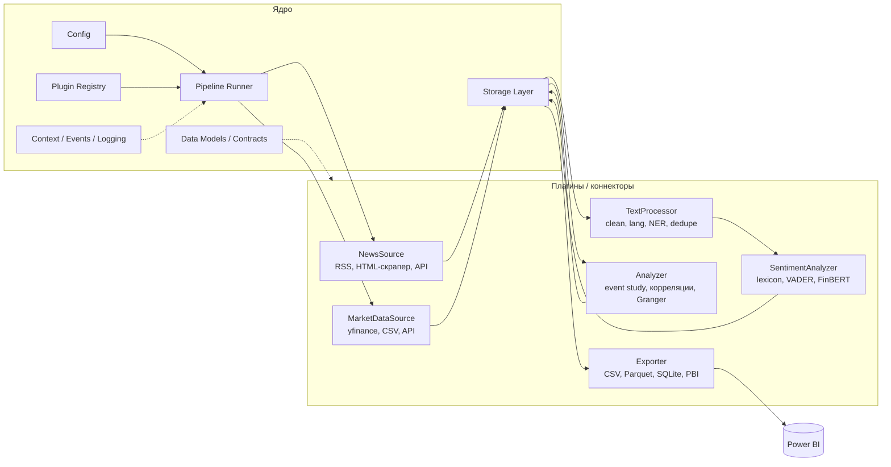

# NewsAlpha — архитектура Python-части

Учебный проект: как новости о компании влияют на её показатели (цена акции, объём торгов, волатильность).
Часть 1 (этот документ) — Python-пайплайн. Часть 2 — отчёт Power BI поверх готовых витрин данных.

---

## 1. Цели и принципы

**Цель:** собрать новости → очистить и обогатить (тональность, сущности) → сопоставить с рыночными данными → проверить статистически, есть ли связь, и аккуратно говорить о причинности.

**Архитектурные принципы (они же — учебные цели):**

| Принцип | Что тренируем |
|---|---|
| Ядро не знает про конкретные источники и модели | Dependency Inversion, интерфейсы (`Protocol` / ABC) |
| Всё расширяется плагинами через реестр | Plugin registry, entry points, фабрики |
| Конфигурация вместо кода | Pydantic-settings, YAML |
| Стадии пайплайна — чистые функции над типизированными данными | Typed data contracts, тестируемость |
| Сырые данные неизменяемы, обработанные — воспроизводимы | Слои хранения (raw / processed / marts) |
| Любой запуск можно повторить | Идемпотентность, run_id, кеширование |

---

## 2. Общая схема



Поток данных по стадиям:

```
ingest_news ─┐
             ├─► preprocess ─► enrich (sentiment, entities) ─► align ─► analyze ─► export
ingest_market┘
```

---

## 3. Структура репозитория

```
newsalpha/
├── pyproject.toml
├── ARCHITECTURE.md
├── configs/
│   ├── base.yaml                 # общие настройки
│   └── experiments/
│       └── aapl_2024.yaml        # конкретный эксперимент
├── src/newsalpha/
│   ├── core/                     # ЯДРО (не импортирует plugins/)
│   │   ├── models.py             # Pydantic-модели: Article, PriceBar, SentimentScore, ...
│   │   ├── interfaces.py         # Protocol'ы всех типов плагинов
│   │   ├── registry.py           # регистрация и поиск плагинов
│   │   ├── config.py             # загрузка и валидация конфигов
│   │   ├── pipeline.py           # оркестратор стадий
│   │   ├── context.py            # RunContext: run_id, config, logger, storage
│   │   ├── storage.py            # интерфейс + базовая реализация хранилища
│   │   └── errors.py
│   ├── plugins/                  # ПЛАГИНЫ (импортируют только core/)
│   │   ├── news_sources/
│   │   │   ├── rss.py
│   │   │   ├── html_scraper.py
│   │   │   └── newsapi.py
│   │   ├── market_data/
│   │   │   ├── yfinance_source.py
│   │   │   └── csv_source.py
│   │   ├── text_processors/
│   │   │   ├── cleaner.py
│   │   │   ├── language_filter.py
│   │   │   ├── deduplicator.py
│   │   │   └── entity_linker.py  # привязка статьи к компании/тикеру
│   │   ├── sentiment/
│   │   │   ├── lexicon.py        # Loughran-McDonald, VADER
│   │   │   └── transformer.py    # FinBERT и т.п.
│   │   ├── analyzers/
│   │   │   ├── event_study.py
│   │   │   ├── lagged_correlation.py
│   │   │   ├── granger.py
│   │   │   └── regression.py
│   │   └── exporters/
│   │       ├── csv_exporter.py
│   │       ├── parquet_exporter.py
│   │       └── sqlite_exporter.py
│   └── cli.py                    # точка входа: newsalpha run configs/...
├── data/
│   ├── raw/                      # неизменяемый сырой слой (HTML, JSON)
│   ├── processed/                # очищенные статьи + тональность
│   └── marts/                    # витрины для Power BI
├── tests/
│   ├── core/
│   └── plugins/
└── notebooks/                    # исследование, не продакшн-код
```

**Правило зависимостей:** `plugins → core`, никогда наоборот. Плагины не знают друг о друге — общаются только через модели данных из `core/models.py`.

---

## 4. Ядро

### 4.1 Контракты данных (`core/models.py`)

Единый язык между стадиями. Pydantic-модели (валидация + сериализация).

```python
class Article(BaseModel):
    id: str                       # хеш от canonical_url
    source: str                   # имя плагина-источника
    url: HttpUrl
    title: str
    body: str | None
    published_at: datetime        # ВСЕГДА в UTC, tz-aware
    fetched_at: datetime
    language: str | None = None
    tickers: list[str] = []       # заполняет entity_linker

class SentimentScore(BaseModel):
    article_id: str
    model: str                    # "vader", "finbert", ...
    label: Literal["neg", "neu", "pos"]
    score: float                  # [-1, 1]
    confidence: float | None = None

class PriceBar(BaseModel):
    ticker: str
    ts: datetime                  # UTC
    open: float; high: float; low: float; close: float
    volume: float | None = None
```

> Важный учебный момент: **часовые пояса и время публикации**. Новость, вышедшая после закрытия биржи, влияет на следующую торговую сессию — это решается на стадии `align`.

### 4.2 Интерфейсы плагинов (`core/interfaces.py`)

```python
class NewsSource(Protocol):
    name: str
    def fetch(self, query: NewsQuery, ctx: RunContext) -> Iterable[Article]: ...

class MarketDataSource(Protocol):
    name: str
    def fetch(self, tickers: list[str], start: date, end: date,
              ctx: RunContext) -> Iterable[PriceBar]: ...

class TextProcessor(Protocol):
    name: str
    def process(self, articles: Iterable[Article], ctx: RunContext) -> Iterable[Article]: ...

class SentimentAnalyzer(Protocol):
    name: str
    def score(self, articles: Iterable[Article], ctx: RunContext) -> Iterable[SentimentScore]: ...

class Analyzer(Protocol):
    name: str
    def run(self, dataset: pd.DataFrame, ctx: RunContext) -> AnalysisResult: ...

class Exporter(Protocol):
    name: str
    def export(self, tables: dict[str, pd.DataFrame], ctx: RunContext) -> None: ...
```

Начни с `Protocol` (структурная типизация), потом можно сравнить с `abc.ABC` и обсудить плюсы/минусы.

### 4.3 Реестр плагинов (`core/registry.py`)

Два уровня сложности — реализуй по очереди:

1. **Декоратор-регистрация** (проще):
   ```python
   @register("news_source", "rss")
   class RssSource: ...
   ```
   Реестр — словарь `{(kind, name): class}`; плагины подгружаются через `importlib` по списку модулей.
2. **Entry points** (`importlib.metadata`): плагины объявляются в `pyproject.toml` и могут жить в отдельных пакетах — так устроены pytest, flake8 и т. д.

Фабрика: `registry.create("news_source", "rss", **params_from_config)`.

### 4.4 Конфигурация (`core/config.py`)

Pydantic-модель, загружаемая из YAML. Пример `configs/experiments/aapl_2024.yaml`:

```yaml
run:
  name: aapl_2024
  seed: 42

company:
  name: Apple Inc.
  tickers: [AAPL]
  aliases: ["Apple", "iPhone maker"]

period: {start: 2024-01-01, end: 2024-12-31}

pipeline:
  news_sources:
    - {plugin: rss, params: {feeds: ["https://..."]}}
  market_sources:
    - {plugin: yfinance, params: {interval: 1d}}
  text_processors:
    - {plugin: cleaner}
    - {plugin: language_filter, params: {allow: [en]}}
    - {plugin: deduplicator, params: {threshold: 0.9}}
    - {plugin: entity_linker}
  sentiment:
    - {plugin: lexicon}
    - {plugin: transformer, params: {model: ProsusAI/finbert}}
  analyzers:
    - {plugin: event_study, params: {window: [-1, 5], estimation_window: 120}}
    - {plugin: lagged_correlation, params: {max_lag: 5}}
    - {plugin: granger, params: {max_lag: 5}}
  exporters:
    - {plugin: parquet}
    - {plugin: csv, params: {path: data/marts}}
```

Смена источника, модели тональности или метода анализа = правка YAML, без изменения кода.

### 4.5 Пайплайн (`core/pipeline.py`)

Оркестратор: читает конфиг → создаёт плагины через реестр → выполняет стадии по порядку.

- Каждая стадия: вход → плагин(ы) → выход → запись в storage.
- Стадии независимы: можно запустить `newsalpha run cfg --only analyze`, если данные уже есть.
- `RunContext` содержит `run_id`, конфиг, логгер, storage, seed.
- Ошибка одного источника не должна валить весь запуск (политика: `fail_fast` / `skip_and_log`).

Упрощённый скелет:

```python
class Pipeline:
    def __init__(self, cfg, registry, storage): ...
    def run(self, only: set[str] | None = None) -> RunReport:
        ctx = RunContext.create(self.cfg, self.storage)
        for stage in self.stages:          # ingest → preprocess → enrich → align → analyze → export
            if only and stage.name not in only: continue
            stage.execute(ctx)
        return ctx.report()
```

### 4.6 Хранилище (`core/storage.py`)

Слои:

| Слой | Формат | Содержимое |
|---|---|---|
| `raw` | JSON/HTML файлы | Ответы источников «как есть», не меняются |
| `processed` | Parquet / SQLite | Очищенные статьи, тональность, цены |
| `marts` | Parquet / CSV | Агрегаты и результаты анализа для Power BI |

Старт: SQLite + Parquet (ноль инфраструктуры). Интерфейс `Storage` позволит позже заменить на DuckDB или PostgreSQL — это отдельное упражнение.

### 4.7 Кросс-срезы

- **Логирование:** `structlog` или `logging` с `run_id` в каждой записи.
- **Кеширование HTTP:** не качать повторно (`requests-cache` / собственный по хешу URL).
- **Rate limiting и retry:** `tenacity` + задержки; уважать `robots.txt` и ToS источников.
- **Идемпотентность:** `Article.id` = хеш канонического URL → повторный запуск не плодит дубли.

---

## 5. Каталог плагинов (план)

| Тип | MVP | Следующий шаг | Усложнение |
|---|---|---|---|
| NewsSource | RSS (feedparser) | HTML-скрапер (httpx + selectolax/BeautifulSoup) | API (NewsAPI, GDELT), архивы |
| MarketDataSource | yfinance | CSV-загрузка | Платные API, интрадей |
| TextProcessor | cleaner, language_filter | deduplicator (MinHash/SimHash) | entity_linker (spaCy NER) |
| Sentiment | словарный (Loughran-McDonald/VADER) | FinBERT | Сравнение моделей, ансамбль |
| Analyzer | lagged_correlation | event_study, regression | Granger, diff-in-diff, синтетический контроль |
| Exporter | CSV | Parquet, SQLite | Прямая загрузка в БД для Power BI |

---

## 6. Стадия `align` — склейка новостей и рынка

Самая «подлая» часть проекта. Решения нужно зафиксировать явно:

1. **Единица времени:** торговый день (старт) → потом интрадей.
2. **Привязка новости к сессии:** новость после закрытия биржи → следующий торговый день. Календарь бирж: `pandas_market_calendars`.
3. **Агрегация новостей за день:** кол-во статей, средняя/взвешенная тональность, макс. отрицательная, доля новостей от «тяжёлых» источников.
4. **Целевые метрики:** доходность (`log return`), **аномальная доходность** (относительно рынка/индекса), объём, волатильность.
5. **Защита от look-ahead bias:** в признаках на день *t* нельзя использовать информацию, недоступную до момента *t*.

Результат стадии — «плоский» датасет: одна строка = (ticker, date) с признаками новостей и метриками рынка.

---

## 7. Методология анализа (про «причинность»)

Корреляция ≠ причинность. Это ядро учебной ценности проекта, поэтому набор анализаторов выстроен как лесенка:

1. **Описательная статистика и лаговые корреляции** — есть ли связь и с каким запаздыванием.
2. **Event study** — выделяем значимые новости (сильная тональность, отсутствие других новостей в окне), считаем аномальную доходность (AR) и накопленную (CAR) вокруг события, тестируем значимость.
3. **Регрессии с контролями** — доходность ~ тональность + рынок + объём + день недели + прошлые доходности.
4. **Тест Грейнджера** — помогает ответить «предсказывает ли тональность доходность» (предсказательность ≠ причинность).
5. **Обратная причинность:** может быть, это цена влияет на тональность новостей (журналисты пишут про уже случившееся падение). Проверяем лаги в обе стороны.
6. **Робастность и плацебо:** перемешать даты новостей (permutation test), проверить другие компании/периоды, разные модели тональности.

Типичные ловушки (в README результатов явно перечислять, что с ними сделано): confounding (отчётность, макро-события), мультиколлинеарность новостей, автокорреляция остатков, множественные сравнения, утечка из будущего, выживший сдвиг.

Каждый анализатор возвращает `AnalysisResult`: метрики, p-values, параметры, ссылка на датасет и версию конфига — чтобы результат можно было воспроизвести и показать в Power BI.

---

## 8. Контракт с Power BI (часть 2)

Python-часть отдаёт **витрины** (`data/marts/`), Power BI ничего не считает «тяжёлого»:

| Таблица | Гранулярность | Назначение |
|---|---|---|
| `fact_daily` | ticker × date | цена, доходность, объём, агрегаты новостей |
| `fact_articles` | статья | заголовок, источник, тональность, ссылка |
| `fact_events` | событие | дата, AR, CAR, значимость, топ-новость |
| `dim_company`, `dim_date`, `dim_source` | справочники | фильтры и срезы |
| `analysis_results` | тест × параметры | коэффициенты, p-values, описание вывода |

Хорошая практика: схема витрин версионируется (`schema_version`), чтобы отчёт не ломался при изменениях.

---

## 9. Тестирование

- **core:** юнит-тесты реестра, конфига, пайплайна (с фейковыми плагинами — отличная демонстрация пользы архитектуры).
- **plugins:** тесты на сохранённых фикстурах (HTML/JSON-образцы), без сети.
- **контрактные тесты:** любой плагин типа X должен проходить общий набор проверок интерфейса X.
- **интеграционный:** мини-пайплайн на 20 статьях и 30 днях цен.
- Инструменты: `pytest`, `hypothesis` (по желанию), `ruff`, `mypy`, `pre-commit`.

---

## 10. Дорожная карта (с учебными целями)

| Этап | Что делаем | Чему учимся |
|---|---|---|
| 0 | Репозиторий, `pyproject.toml`, ruff/mypy/pytest | Структура Python-проекта, src-layout |
| 1 | `core/models.py`, `interfaces.py`, `registry.py`, `config.py` | Protocol, декораторы, Pydantic |
| 2 | Пайплайн + 1 фейковый плагин на каждый тип + тесты | DI, тестирование с заглушками |
| 3 | `rss` + `yfinance` + SQLite/Parquet storage | Реальные данные, идемпотентность |
| 4 | cleaner, language_filter, dedupe, entity_linker | Обработка текста, NER |
| 5 | Тональность: словарь → FinBERT | NLP, сравнение моделей |
| 6 | `align` + `lagged_correlation` | Time series, look-ahead bias |
| 7 | `event_study`, регрессии, Granger | Статистика, причинность |
| 8 | HTML-скрапер, ещё источники | Скрапинг, этика, rate limiting |
| 9 | Exporters + витрины для Power BI | Контракты данных |
| 10 | Entry points, плагин как отдельный пакет | Packaging |

**MVP (этапы 0–3 + 6):** один источник новостей, одна компания, дневной шаг, словарная тональность, лаговая корреляция.

---

## 11. Этика и ограничения

- Проверять `robots.txt` и условия использования сайтов; предпочитать RSS/официальные API скрапингу.
- Не хранить и не публиковать полные тексты статей (авторские права) — достаточно метаданных, ссылок и производных признаков.
- Проект учебный: результаты не являются инвестиционной рекомендацией.

---

## 12. Идеи для самостоятельных упражнений

1. Написать второй плагин-источник и убедиться, что ядро **не пришлось менять**.
2. Добавить общий декоратор `@cached` для плагинов, ходящих в сеть.
3. Реализовать плагин `Analyzer`, сравнивающий две модели тональности на одних данных.
4. Вынести один плагин в отдельный пакет и подключить через entry points.
5. Добавить стадию-хук (`before_stage` / `after_stage`) для замера времени — это про event bus и middleware.
